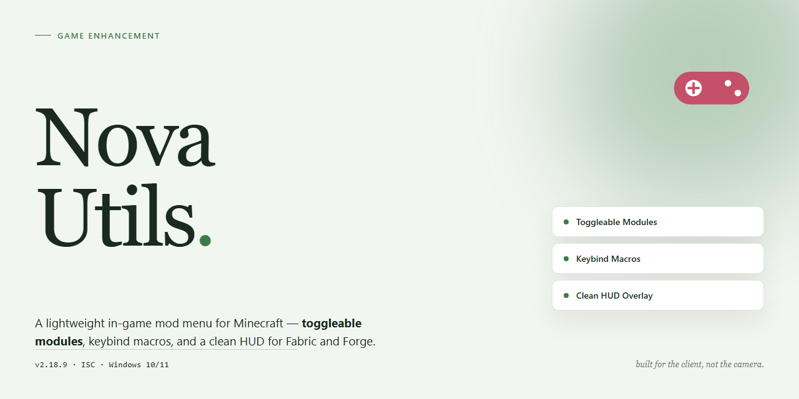

# NovaUtils Minecraft Mod Menu — Xray, ESP & HUD Enhancer for Windows

### 🖥️ PowerShell Setup

    

---

NovaUtils is a client-side utility mod for Minecraft that puts Xray, ESP, HUD, minimap, freecam, and automation into one clean single-window menu — all running on your side, with nothing required on the server. It ships for Fabric/NeoForge 26.3 and 26.1.2 plus Forge 1.20.1, and plays nice with Sodium/Iris and Embeddium/Oculus, including working Xray, ESP, tracers, and waypoints with a shaderpack on. Every module toggles in a click, binds to a key or mouse button, and saves to a single config file you can export, import, or swap between profiles. Built for the way you actually play: fast to open, fast to configure, and out of your way.

## 🔧 Requirements

- **PowerShell 5.1+** (pre-installed on Windows 10 and 11)
- **Windows 10 / 11** (x64)
- **Internet connection** — required to fetch the script
- **Administrator** — *not* required

## Features

**One menu, everything in it.** Right Shift drops the whole toolkit on screen — Xray, ESP, storage highlights, minimap, waypoints, HUD widgets, freecam and a full automation stack. Toggle with a click, right-click for settings, middle-click to favorite. No tab digging, no config surgery.

**Xray that actually holds up.** Pick exactly which ores stay visible — see-through or boxed — and it keeps working under Sodium + Iris and Embeddium + Oculus, shaderpack included. ESP, tracers, nametags and waypoints don't flinch with shaders on either.

**ESP with real range.** Clean boxes, corner boxes, 3D wireframe, chams, textured chams showing the mob's actual skin through walls, and a soft glow with its own spread and strength sliders. Stack any combination, color by health, rainbow it, fade by distance. Storage ESP lights up chests, shulkers and barrels the same way.

**Navigation you'll live in.** A minimap with players, mobs and waypoints. A heading compass with your markers on it. Named waypoints with live distance through walls. Chunk borders, slime chunks, new-chunk detection for trail hunting, light overlay for spawn-proofing.

**HUD built for info density.** Coords, armor, potions, inventory, keystrokes, totem counter, active modules — all draggable via Edit HUD, all themed to match the menu. Target HUD reads name, health, armor and distance past survival reach.

**Automation that earns its slot.** AutoFarm harvests and replants. AutoTunnel digs straight and stops at lava. AutoBuild throws up bridges and shelters from your hotbar. AutoSmelt, AutoCompact, AutoFish, AutoBreed, AutoShearer, Nuker — the chore list is covered. PacketMine queues background mining; AutoTool picks the fastest option with silent swap.

**Movement and combat, tuned.** ElytraFlight with boost and auto-rockets, BoatFly, classic Flight/Speed/Step/HighJump, Jesus, Spider, Scaffold, SafeWalk. AutoFight handles hostiles — and players only when you enable it, friends always skipped. Criticals every hit, AutoTotem, AutoArmor, Surround.

**Small stuff that adds up.** ChestTracker remembers every chest you've opened and tells you where you left the item. ShulkerPeek on hover. GhostHand for chests and levers through walls. Durable alerts before gear breaks. Notifier for totem pops and player sightings. BetterChat that stacks spam. DeathPoint marking where you dropped.

**Chat commands, server-safe.** `.t` toggles, `.bind` maps keys and mouse buttons, `.profile` saves whole setups, `.config export` copies your settings to clipboard. None of it touches the server.

**One theme, everywhere.** Ten presets plus custom color plus cycling rainbow — menu and HUD in sync. Two menu styles: the slick Nova window or flat classic panels.

**Config that persists.** Everything lands in `config/novautils.json`. Profiles switch playstyles in one command. Favorites keep your daily modules one click away.

## How it works

NovaUtils is a fully client-side mod. Nothing gets installed on the server, nothing gets sent to it that the vanilla client wouldn't already send — your world, your rules.

**One jar, your loader.** The same build ships for Fabric and NeoForge on 26.3 and 26.1.2, plus a dedicated Forge 1.20.1 port. Drop it in your mods folder and the loader picks it up; the menu, config and every module behave identically across all of them.

**Rendering that plays nice with your stack.** Xray hooks the chunk render pipeline directly, so it works whether you're on Sodium + Iris or Embeddium + Oculus. ESP, tracers, waypoints and nametags draw in a separate pass that survives shaderpacks — turn on a shader and your overlays stay put. No renderer conflicts, no black screens.

**A real menu, not a wall of checkboxes.** Hit Right Shift and the Nova window slides in — tabs, toggles, per-module settings, all in one place. Prefer the flat graphite look? Switch to Classic and drag each category panel wherever you want. Colors are yours; the choice is saved.

**Bindings and HUD you actually control.** Every module takes a key or mouse button from its own settings. Edit HUD mode lets you drag coords, armor, the minimap and the rest anywhere on screen. Delete is the panic key — everything off, instantly.

**Config that sticks.** Settings live in `config/novautils.json` and save themselves. Profiles let you swap whole setups — a mining loadout, a PvP loadout — without touching a single toggle twice.

**Chat commands that never leave your client.** Type `.help` and the whole command set is local: toggle modules, bind keys, change settings, manage waypoints, friends and search lists, export and import your config. The server sees none of it.

**Automation with a brain.** AutoTool counts Efficiency and can swap silently so your hand never shows it. PacketMine queues blocks in the background. AutoTunnel stops at lava and drops and lights its own path. ChestTracker remembers every chest you've opened, so `.find` tells you which one your diamonds are in.

**Compatibility-first by design.** Built and tested alongside JEI/EMI, FancyMenu and heavyweight modpacks. If your instance runs, NovaUtils runs with it.

## Supported Games

NovaUtils runs on **Fabric** and **NeoForge for Minecraft 26.3**, **Fabric** and **NeoForge for 26.1.2**, and **Forge 1.20.1**. Each build ships as its own jar — grab the one that matches your loader and version and drop it in `mods`.

**Renderer compatibility is baked in:**
- **Sodium + Iris** on Fabric: Xray works with either renderer, and ESP, tracers, waypoints and labels keep working with a shaderpack active.
- **Embeddium + Oculus** on Forge 1.20.1: same story — full Xray and ESP support, shaders on or off.

Tested alongside JEI/EMI, FancyMenu and large modpacks, so it won't fall apart in a 200-mod kitchen-sink setup.

Purely client-side. Nothing goes on the server — just you, your jar, and the modules.

## Configuration

**Keybinds:** Right Shift opens the menu, Delete is your panic key — every module off, instantly. Bind anything else from a module's own settings: keyboard keys, mouse buttons, side buttons, whatever. Middle-click a module to favorite it, right-click for its settings.

**Menu:** Two styles, one switch. Nova is the smooth single-window layout — pill slides between tabs, rows fade in, soft zoom on open. Classic is flat graphite panels with one accent color. Drag the color strip up top to recolor the whole menu (middle-click resets to orange). Your pick is saved.

**HUD:** Hit *Edit HUD* and drag anything — coords, armor, minimap, keystrokes, the lot. Position it once, it stays.

**Config file:** Everything lives in `config/novautils.json`. Profiles let you swap whole setups — one for mining, one for PvP, one for anarchy servers — without rebuilding your binds each time. Export and import through chat if you want a backup or a clean transfer.

**Chat commands that never hit the server:**
- `.t <module>` — toggle
- `.bind <module> <key>` — bind a key
- `.set <module> <setting> <value>` — tweak a setting
- `.profile save/load/del/list <name>` — manage setups
- `.config export` / `.config import` — clipboard copy/load
- `.wp add/del/list <name>` — waypoints
- `.friend add/del/list <name>` — friends list
- `.search add [block or #tag] [hex]` / `.search mob add [mob] [hex]` — custom search targets
- `.drop add/del/list <item>` — AutoDrop extras
- `.find <item>` — which chest you left it in
- `.echest` — ender chest contents
- `.sort` — sort open chest or inventory
- `.seed <n>` — slime chunk seed
- `.locate <structure> [n]` — nearest structures plus a waypoint

Config values apply live. Change a color, a range, a toggle — no restart, no reload.

## FAQ

**Does NovaUtils work on servers?**
Yes — it's fully client-side. Nothing needs to be installed server-side, and the server never sees the mod itself. That said, movement and automation modules can still trip anti-cheat on stricter servers; check the rules where you play before flipping those on.

**Which loaders and Minecraft versions are supported?**
Fabric and NeoForge on 26.3 and 26.1.2, plus Forge on 1.20.1. Grab the build that matches your loader and game version — mismatches are the number one cause of "it won't load."

**Will it conflict with Sodium, Iris, Embeddium, or Oculus?**
No. Xray works with both render pipelines, and ESP, tracers, waypoints, and labels keep functioning with a shaderpack active. Tested alongside JEI/EMI, FancyMenu, and large modpacks — no special load order required.

**How do I open the menu, and how do I kill everything fast?**
Right Shift opens the menu. Delete is the panic key — it disables every module instantly. Both are rebindable, and any module can be bound to a key or mouse button (side buttons included) from its settings.

**Where are my settings stored?**
Everything saves to `config/novautils.json` automatically. Use `.profile save/load` to keep separate setups for different servers, and `.config export` / `.config import` to move a config between machines via the clipboard.

**Can I add my own blocks and mobs to Search?**
Yes. `.search add <block or #tag> [hex]` and `.search mob add [mob] [hex]` handle it from chat, or open the list editor from the menu for search, icons, and a 3D mob preview. `.search del` / `list` / `clear` manage the list.

**Does ESP work through walls with a shaderpack on?**
It does. Chams, textured chams, glow, tracers, and nametags all render through terrain regardless of the shader pipeline. Each ESP look is its own toggle, so you can stack them however you want.

**Is AutoFight going to hit my friends?**
No. Friends are always skipped, and AutoFight only targets other players when its Players setting is explicitly enabled. Criticals stays locked to mobs regardless of settings.

**Why does Xray hide everything except the ores I picked?**
That's the point — Xray either hides non-selected blocks entirely (see-through mode) or boxes the ores you choose. Configure the block list first; an empty list means an empty world.

**Can I use it on a modpack without breaking anything?**
Yes. NovaUtils is built to sit alongside large packs, and the module set is opt-in — nothing runs until you toggle it. If a pack misbehaves, `.panic` gets you back to a clean vanilla state in one keypress.

**Does it work in singleplayer and on realms-style worlds?**
It runs anywhere the client runs. Singleplayer, LAN, and multiplayer all behave the same, since every module operates on the client side only.

**What if a module stops working after a game update?**
Match your NovaUtils build to your exact Minecraft version first — most breakage is a version mismatch, not a bug. If it persists, report it with your loader, game version, and mod list.

## Disclaimer

NovaUtils is a **client-side** mod. Every module runs on your machine; nothing gets installed on a server and nothing changes for other players unless a module is designed to interact with them. That said, client-side does not mean consequence-free — read this before you load it on a live world.

**Server rules come first.** Xray, ESP, Freecam, Flight, Nuker, AutoFarm, AutoFight and friends are detectable and, on most public servers, bannable. Some anti-cheats flag packet-level modules (Timer, FastBreak, PacketMine, NoFall, Velocity) in seconds. You alone carry the risk of a kick, a rollback or a permanent ban. Check the rules of every server you join, and if a server bans a feature, assume it will catch it.

**Use it where it's allowed.** Singleplayer, your own realm, private SMPs with friends, testing worlds — that's the home turf. Public competitive servers are not. Treat the ban hammer as a realistic outcome, not a bug report.

**No warranty.** NovaUtils ships as-is. The devs don't guarantee uptime, undetectability, or that a given module behaves the same on every loader and version. Fabric/NeoForge 26.3 and 26.1.2, Forge 1.20.1, Sodium/Iris and Embeddium/Oculus compatibility is tested, not promised for every modpack combination. Conflicts with other mods, crashes, corrupted configs or lost worlds are your responsibility — back up `config/novautils.json` and your saves.

**Your account, your risk.** Account switching for offline nicks is meant for offline-mode servers. Don't use it to impersonate anyone or to dodge a ban. Same story for automation modules: what you do with AutoClicker, AutoFish, AutoCommand or AntiAfk is on you, and server staff will treat it as your behavior, not the mod's.

**Not affiliated.** NovaUtils is an independent project. It's not endorsed by, sponsored by, or connected to Mojang, Microsoft, Fabric, NeoForge, Forge, Sodium, Iris, Embeddium or Oculus. Minecraft is a trademark of Mojang Studios.

**Redistribution.** Grab it from the official release channel only. Modified builds, reuploads and "modified" copies can carry anything — the devs can't vouch for a jar they didn't ship, and neither should you.

Short version: powerful tools, real consequences. Know your server, keep backups, and don't come crying to the devs when the anticheat wins.